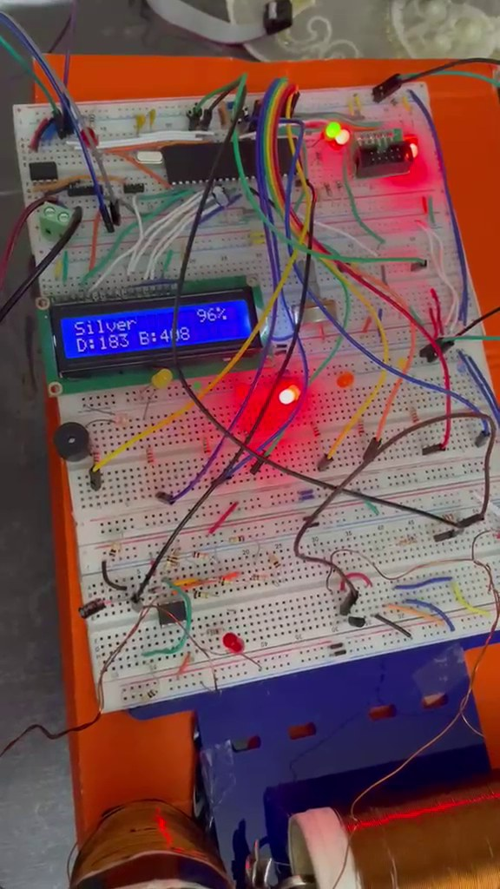
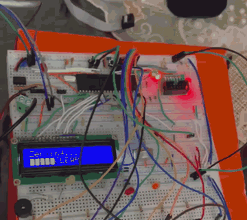
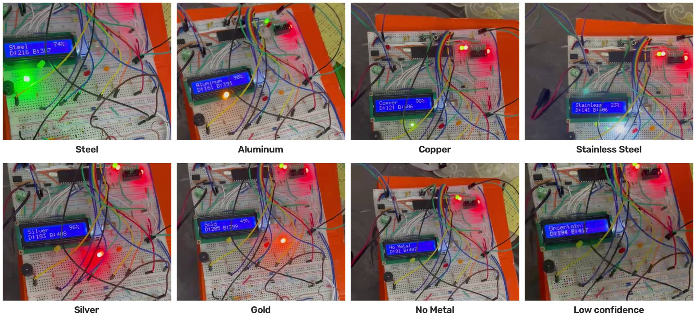
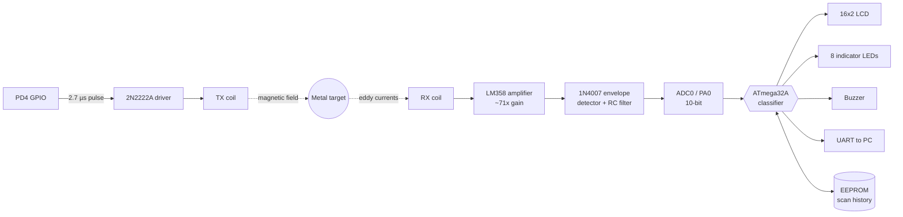
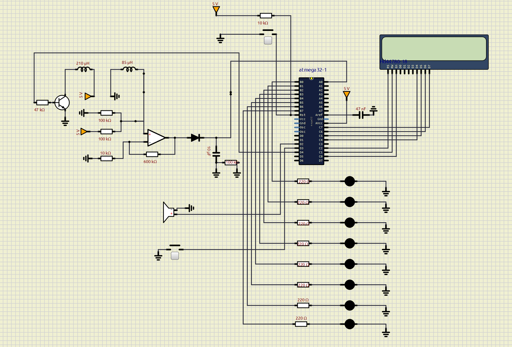
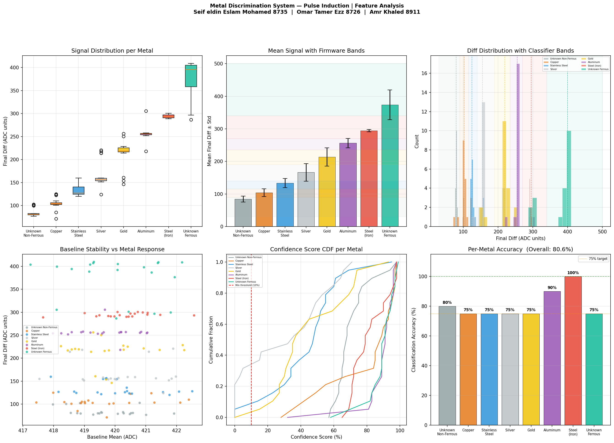

<div align="center">

# Pulse Induction Metal Classifier

**A real-time metal detector that identifies *which* metal it sees, built on a bare-metal AVR ATmega32A.**


<br>



<sub>The finished build identifying a silver sample at 96% confidence.</sub>

</div>

---

## Overview

Most hobby metal detectors only answer *"is there metal?"*. This one answers *"what metal is it?"*.

A two-coil **Pulse Induction (PI)** sensor fires short magnetic pulses and measures how a nearby object distorts the echo. Different metals change the echo by different amounts, depending on their conductivity and permeability. Firmware on an **ATmega32A** (2 KB RAM, no RTOS) turns that change into one of **eight classes**. It reports the result on an LCD, LEDs, a buzzer and a UART data stream.

**Highlights**

- **8-class discrimination:** Steel, Stainless Steel, Copper, Aluminum, Silver, Gold, Unknown Ferrous, Unknown Non-Ferrous
- **Self-calibrating:** every scan re-measures its own baseline, so temperature and supply drift don't skew results
- **Confidence scoring** for every result, with an automatic *"Uncertain!"* warning below 10%
- **Persistent history:** the last 3 scans are stored in EEPROM and survive power loss
- **Data pipeline:** samples stream over UART into a labeled dataset, which a Python script analyzes to tune the classifier
- **80.6% accuracy** across 160 labeled scans, and **100% on steel**

## Demo

<p align="center">
  
  <br>
  <sub>One full scan cycle (sped up): zeroing → scanning → <b>Silver 96%</b>, with its LED lit.</sub>
</p>

**One result for each class**

<p align="center">
  
</p>

Full-length recordings for each metal are in [`media/videos/`](media/videos):
[Steel](media/videos/steel.mp4) ·
[Aluminum](media/videos/aluminum.mp4) ·
[Copper](media/videos/copper.mp4) ·
[Stainless steel](media/videos/stainless_steel.mp4) ·
[Silver](media/videos/silver.mp4) ·
[Gold](media/videos/gold.mp4) ·
[No metal](media/videos/no_metal.mp4) ·
[Low confidence](media/videos/silver_low_confidence.mp4)

> The demo recordings were made during development, so the raw `D:` values on screen come from an earlier calibration than the final bands listed below.

## System architecture



### Circuit schematic

<p align="center">
  
</p>

The full circuit is also available as a Proteus simulation in [`hardware/proteus_simulation.sim1`](hardware/proteus_simulation.sim1).

## How it works

### 1. Sensing

Each measurement fires **64 pulses** and averages the results to suppress noise:

1. Drive the TX coil for about 2.7 µs through PD4
2. Release, so the collapsing field induces a spike in the RX coil
3. Wait 7 µs for the spike to peak
4. Sample the conditioned signal on ADC0
5. Rest 300 µs before the next pulse

### 2. Scan sequence

| Phase    | Samples | Warm-up (discarded) | Averaged | Purpose |
|----------|---------|---------------------|----------|---------|
| Zeroing  | 70      | 50                  | 20       | Measure the baseline with no metal present |
| Scanning | 80      | 50                  | 30       | Measure the signal with the target in place |

The classifier works on `diff = |scan_mean − baseline_mean|`. Because the baseline is re-measured on every scan, slow drift cancels out.

### 3. Classification

`diff` is matched against calibrated bands. Each band was derived from the collected dataset.

| Metal               | Band (ADC counts) | Center | LED | Buzzer pattern   |
|---------------------|-------------------|:------:|:---:|------------------|
| Unknown Non-Ferrous | 30 – 90           | 80     | PB7 | 1 short          |
| Copper              | 90 – 115          | 103    | PB2 | 4 short          |
| Stainless Steel     | 115 – 140         | 125    | PB3 | 3 short          |
| Silver              | 140 – 190         | 155    | PB4 | 5 short + medium |
| Gold                | 190 – 235         | 220    | PB5 | 5 short + long   |
| Aluminum            | 235 – 270         | 255    | PB1 | 5 short          |
| Steel (Iron)        | 270 – 340         | 295    | PB0 | 2 short          |
| Unknown Ferrous     | 340 – 500         | 400    | PB6 | 1 long           |

A `diff` below 10 counts reads as **No Metal**.

**Confidence** depends on how close `diff` is to the center of its band:

```
confidence = (1 − |diff − center| / (band_width / 2)) × 100%
```

### 4. Output

- **LCD** line 1: metal name and confidence (for example `Copper      87%`)
- **LCD** line 2: raw diff and baseline (for example `D:103 B:420`)
- **LED**: the matching indicator lights
- **Buzzer**: a pattern unique to each metal
- **UART** (9600 8N1): every sample, running mean, final diff, ratio and confidence, in a CSV-friendly format

## Results

Evaluated on **160 labeled scans** (20 per class):

| Metal               | Correct | Accuracy |
|---------------------|:-------:|:--------:|
| Steel (Iron)        | 20 / 20 | **100%** |
| Aluminum            | 18 / 20 | **90%**  |
| Unknown Non-Ferrous | 16 / 20 | 80%      |
| Copper              | 15 / 20 | 75%      |
| Stainless Steel     | 15 / 20 | 75%      |
| Silver              | 15 / 20 | 75%      |
| Gold                | 15 / 20 | 75%      |
| Unknown Ferrous     | 15 / 20 | 75%      |
| **Overall**         | **129 / 160** | **80.6%** |

<p align="center">
  
</p>

**Findings**

- **Ferrous metals separate clearly.** Steel produces a large, tight response (std of about 3 counts), which explains its 100% accuracy.
- **The baseline is stable.** It stays within about 5 ADC counts (417–422) across all sessions, which confirms that per-scan re-zeroing works.
- **Silver and gold overlap** around 150–220 counts. This is where most misclassifications happen, and it is the clearest target for future improvement.

## Repository structure

```
.
├── firmware/
│   ├── Metal.c                  # Final firmware (single-file, bare-metal C)
│   ├── metal_detector.hex       # Pre-built firmware image
│   └── Final_project.X/         # MPLAB X IDE project
├── hardware/
│   └── proteus_simulation.sim1  # Full circuit simulation
├── analysis/
│   ├── metal_analysis.py        # Statistics, accuracy and plots
│   ├── metal_dataset.csv        # 160 labeled measurements from UART
│   └── requirements.txt
├── docs/
│   ├── technical_report.pdf     # Full design and evaluation report
│   ├── coil_specifications.pdf  # Coil design
│   └── images/
└── media/
    └── videos/                  # Demo recordings for each metal
```

## Getting started

### Hardware

| Component         | Role |
|-------------------|------|
| ATmega32A @ 11.0592 MHz | Main controller |
| 2 × wound coils   | Transmit and receive |
| 2N2222A NPN       | TX coil driver |
| LM358 op-amp      | RX signal amplifier |
| 1N4007 + RC filter| Envelope detector |
| HD44780 16×2 LCD  | Display (4-bit mode) |
| 8 × LED + 220 Ω   | Class indicators |
| Buzzer, push button | Audio feedback, scan trigger |

<details>
<summary><b>Pin mapping</b></summary>

| Pin        | Function |
|------------|----------|
| PA0 (ADC0) | Envelope detector output |
| PB0 – PB7  | Indicator LEDs |
| PC0        | LCD E |
| PC1        | LCD RW |
| PC2        | LCD RS |
| PC4 – PC7  | LCD D4 – D7 |
| PD1 (TXD)  | UART TX to PC |
| PD2        | Buzzer |
| PD3        | Scan button (active low, internal pull-up) |
| PD4        | TX coil driver |

</details>

### Build and flash

**Option A, MPLAB X:** open `firmware/Final_project.X` and build.

> The MPLAB project contains an earlier calibration of `Metal.c`. Copy `firmware/Metal.c` over it to build the final version.

**Option B, command line:**

```sh
avr-gcc -mmcu=atmega32 -Os -o metal.elf firmware/Metal.c
avr-objcopy -O ihex -R .eeprom metal.elf metal.hex
avrdude -c usbasp -p m32 -U flash:w:metal.hex:i
```

Or flash the pre-built image directly:

```sh
avrdude -c usbasp -p m32 -U flash:w:firmware/metal_detector.hex:i
```

**Option C, simulation:** open `hardware/proteus_simulation.sim1` in Proteus and load the hex file into the ATmega32.

### Usage

1. Power on. The LCD shows **Ready!**, then cycles through the last 3 saved scans.
2. Keep the coil clear of metal and press the button. The LCD shows **Zeroing...** while it captures the baseline.
3. After **two beeps**, place the target on the coil. The LCD shows **Scanning...**.
4. The result appears on the LCD, its LED lights and the buzzer plays that metal's pattern.

To watch raw data live, open a serial terminal at **9600 baud, 8N1**.

### Data analysis

```sh
pip install -r analysis/requirements.txt
python analysis/metal_analysis.py
```

This prints per-class statistics and accuracy, and regenerates `docs/images/analysis_plots.png`.

## Future work

- Replace fixed bands with a nearest-centroid or k-NN classifier that uses more than one feature, such as signal decay rate, to separate silver from gold
- Sample at several delays after each pulse to capture the decay curve, not just one point
- Calibrate per coil automatically from a short reference routine

## Documentation

- [Technical report](docs/technical_report.pdf): design rationale, circuit analysis, calibration and evaluation
- [Coil specifications](docs/coil_specifications.pdf): coil design and electromagnetic parameters

## Team

| Name | Student ID |
|------|-----------:|
| **Amr Khaled** | 8911 |
| Omar Tamer Ezz | 8726 |
| Seif eldin Eslam Mohamed | 8735 |

*Embedded Systems Final Project, Spring 2026.*

## License

Released under the [MIT License](LICENSE).
